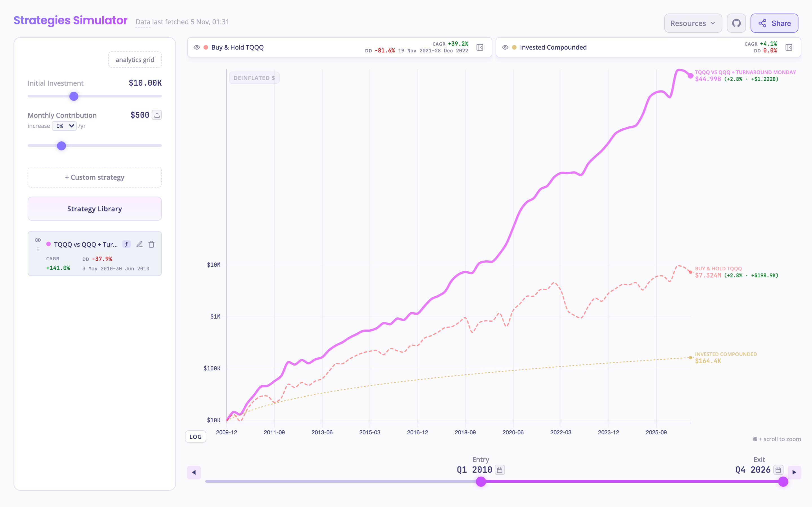
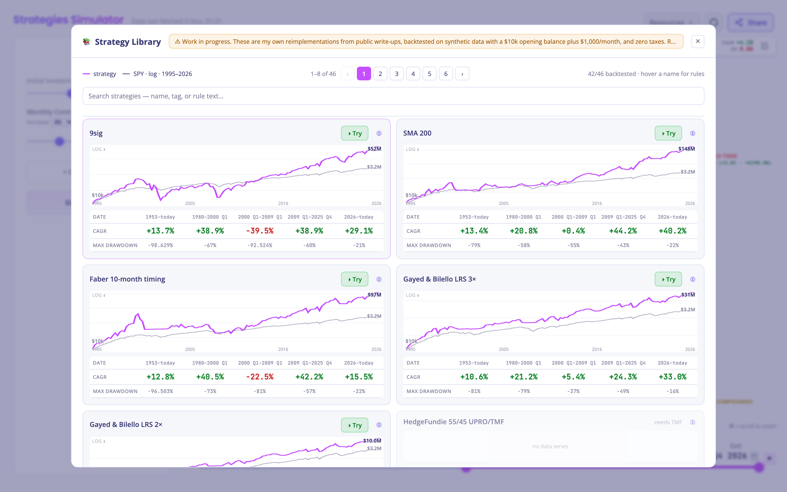
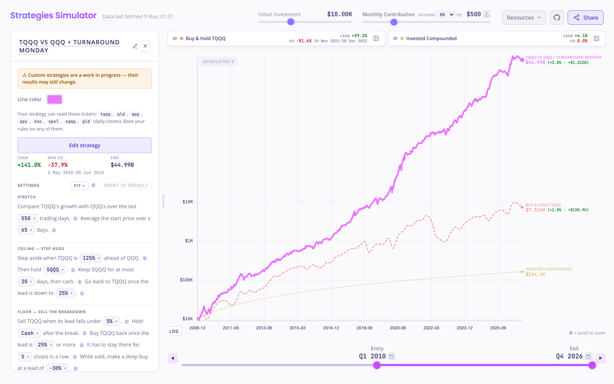
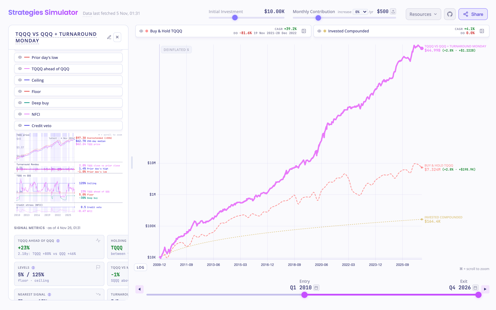
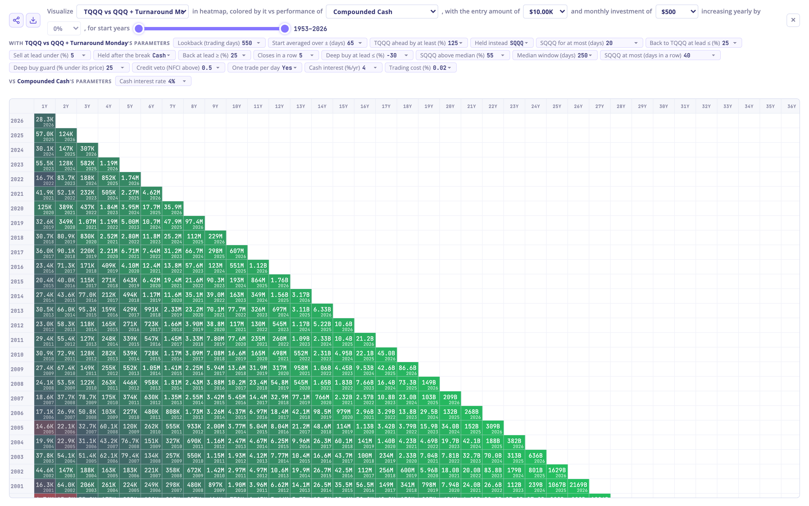
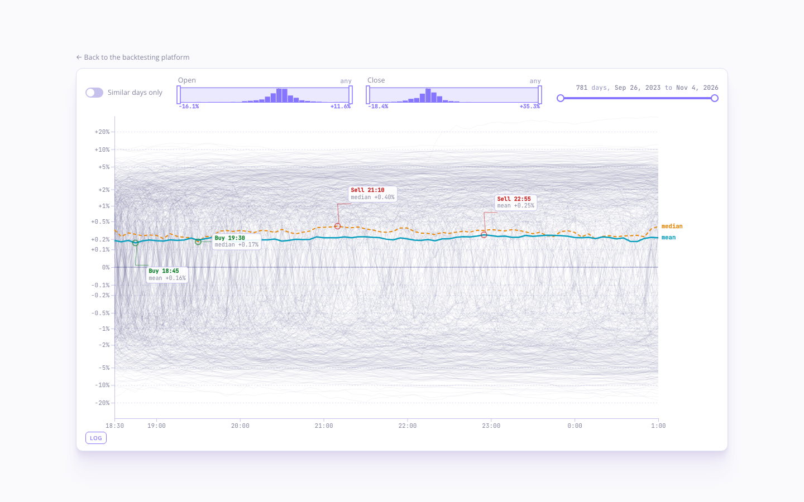
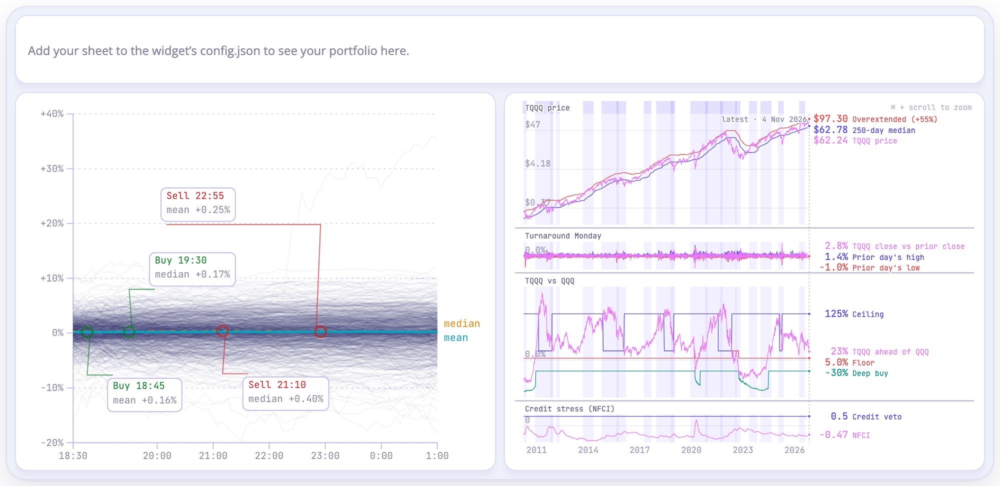

# tqqq.networthcast.com

Backtesting platform for TQQQ. Strategies run over a reconstructed daily price history that starts in 1953, on TQQQ and nine related funds (QQQ, QLD, SQQQ, SPY, SSO, SPXL, GLD, SOXL, SOXX): SMA timing, 9Sig, a library of 46 published and community rules, and custom strategies written in JavaScript, with buy & hold and a cash baseline drawn alongside. A real transaction history can be uploaded to put your own portfolio on the same chart, a separate page follows TQQQ's intraday path session by session, and a desktop widget shows both.

Live: https://tqqq.networthcast.com

## What it looks like



$10K plus $500 a month from 2010: TQQQ vs QQQ + Turnaround Monday from the library, buy & hold TQQQ, and the contributions on their own. Log scale; entry and exit sit on the slider under the chart.

### Strategy library



46 strategies: published rules, community favourites and a few of the site's own. Each card has its rules, a sparkline against SPY, and CAGR and max drawdown by era. Try puts one on the chart.

### Settings as sentences, Fit, signal charts



A library strategy's settings read as sentences. Every dropdown shows what each value would have made, and Fit searches them for the best CAGR, or the lowest drawdown that still beats buy & hold.



The signal chart draws the rules' lines on the price, the lead over QQQ with its ceiling, floor and deep-buy levels, and the credit-stress index with its veto. Each trade is marked where its rule fired, and today's readings sit on the right.

### Analytics grid



Every start year and holding period at once, coloured against a baseline (here compounded cash).

### Intraday page



[experiments/tqqq-intraday.html](experiments/tqqq-intraday.html): every session's 5-minute path since September 2023, the mean and median path, and filters by the day's open and close. Hover for the path nearest the pointer; drag across the plot for the move over that span on today's path, the mean, the median and the nearest day.

### Desktop widget



[widget.html](widget.html), framed by an Übersicht widget: today's intraday path and a strategy's signal chart. A private `config.json` adds your own portfolio. See [widget/README.md](widget/README.md).

## Repository layout

| Path | What it is |
|---|---|
| `index.html`, `js/`, `styles.css` | The site. GitHub Pages serves the root of `main`, so `CNAME` and `.nojekyll` stay there. |
| `data/` | Price, rate and intraday series, refreshed by the workflow. Format, synthesis and known biases: [data/README.md](data/README.md). |
| `experiments/` | The intraday page and the 9sig and SMA overfit explorers, linked from the site. |
| `widget.html`, `widget/` | The widget page and its installer. |
| `scripts/` | The data updaters the workflow runs. |
| `tests/` | Node checks: library parity, withdrawals, daily display. |
| `research/` | Notes and scripts behind the library. |
| `old/v1/` | The frozen first version. Old share links redirect there. |

## Updating price data

The series under `data/` are TSV files: ten price files, their daily highs and lows, three short-rate files, NFCI, and TQQQ's intraday bars. See [data/README.md](data/README.md) for the format, the synthesis method, and its known biases.

```bash
# One-time setup (creates a venv and installs yfinance)
python3 -m venv .venv
.venv/bin/pip install yfinance

# Default: incremental refresh of the price TSVs
.venv/bin/python3 scripts/update_data.py
```

The default run pulls `period="max"` with `auto_adjust=True`, so every series is dividend- and split-adjusted on the same basis and comparisons between them stay fair. It replaces the post-IPO tail of each price file and copies the committed pre-IPO synthesized prefix through untouched. It does not contact FRED, so the rate files are left alone.

Price files: `synthetic-qqq.tsv`, `synthetic-qld.tsv`, `synthetic-tqqq.tsv`, `spy.tsv`, `synthetic-sso.tsv`, `synthetic-spxl.tsv`, `synthetic-sqqq.tsv`, `synthetic-gld.tsv`, `synthetic-soxl.tsv`, `synthetic-soxx.tsv`.

High/low files, written on the same runs from the same bars: `tqqq-hl.tsv`, `qqq-hl.tsv`, `spy-hl.tsv` (date, high, low and that bar's close; real trading days only). The Turnaround Monday strategies read them.

Flags cover the rest:

- `--refresh-rates` re-pulls DFF and TB3MS from FRED and rewrites `fed-funds-effective.tsv`, `t-bill-3mo.tsv`, and `short-rates.tsv`. Nothing else refreshes these, so they drift stale until you run it.
- `--rebuild` regenerates every price TSV from scratch through the backward-synthesis pipeline. It needs a local `^ndx_d.csv` (Stooq) at the repo root to reach pre-1985 Nasdaq history; that file is not committed, and without it the rebuild stops where Yahoo's `^NDX` stops. Run it when adding a ticker or changing the synthesis.
- `--high-low-history`, `--gold-history`, `--soxl-history` and `--soxx-history` rebuild the pre-launch rows of the high/low files, of `synthetic-gld.tsv`, `synthetic-soxl.tsv` and `synthetic-soxx.tsv`. [data/README.md](data/README.md) has the details.

## Automated refresh

`.github/workflows/update-data.yml` runs `scripts/update_data.py` in its default incremental mode, then `scripts/update_intraday.py --incremental` (Alpaca 5-minute bars) and `scripts/update_intraday_today.py` (today's 1-minute bars from Yahoo), and commits changed TSVs back to `main`.

- **Schedule**: hourly on weekdays, `30 13-22 * * 1-5`. That's ten fires, and a gate step drops any that falls outside 09:00–17:30 ET, leaving nine runs per trading day.
- **DST**: GitHub cron is fixed UTC. 13:30–22:30 UTC covers 09:30–18:30 ET in summer and 08:30–17:30 ET in winter, so the gate trims one fire off whichever end the current offset pushes out. Either way the day runs 09:30 to 17:30 ET.
- **Manual trigger**: `workflow_dispatch` runs it on demand from the Actions tab and skips the clock gate.
- **No-op on holidays**: the commit step checks `git diff --quiet -- 'data/*.tsv'` and exits cleanly when nothing changed.
- **Overlapping runs**: a `concurrency` group with `cancel-in-progress: false` queues a delayed run instead of killing it, and the push step rebases first, since two runs writing `data/*.tsv` would otherwise race.
- **Rate limits**: yfinance throttles shared CI IPs, and nine runs a day each pull `period="max"` for every price ticker. The refresh step retries once after 120s so a transient 429 lands as a later refresh rather than a failed run.
- **Permissions**: the workflow uses the default `GITHUB_TOKEN` with `contents: write`. If org-level settings block workflow pushes, flip *Settings → Actions → General → Workflow permissions* to "Read and write".
